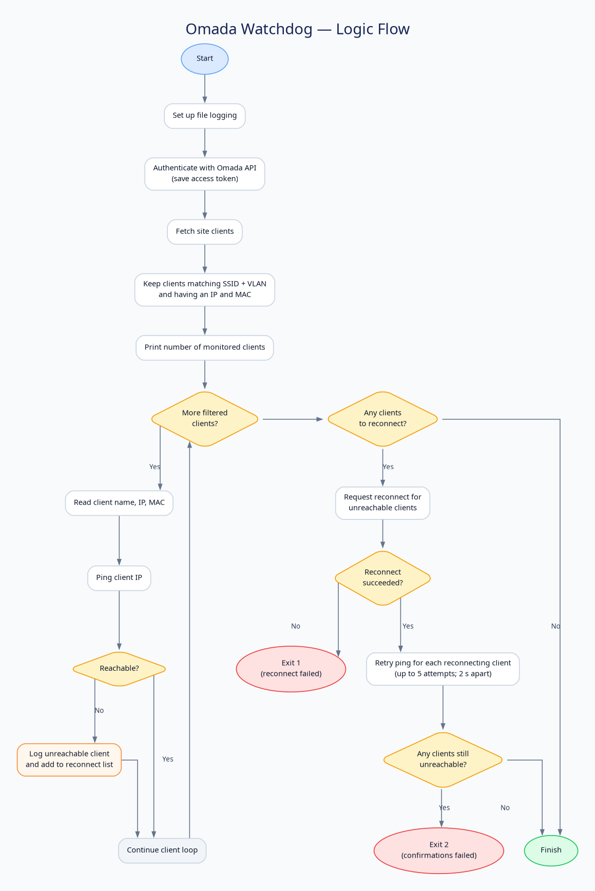

# Omada Watchdog

`omadawatchdog.py` checks clients connected to a configured Omada site. It
filters them by SSID and VLAN, pings each client's IP address, and asks the
Omada controller to reconnect clients that do not respond. After a reconnect,
it retries pinging each affected client up to five times, with a two-second
interval.



## Requirements

- Python 3
- Network access from the machine running the watchdog to the Omada controller
  and monitored clients
- Omada Open API enabled, with a client ID and client secret created in the
  controller under **Global Settings > Platform Integration > OpenAPI**
- The Python `requests` package

Install the dependency if it is not already available to the Python
interpreter you will use to run the scripts:

```sh
python3 -m pip install requests
```

## Configure with the setup script

Run the interactive setup script:

```sh
python3 /path/to/omadawatchdog/omadawatchdogsetup.py
```

Replace `/path/to/omadawatchdog` with the absolute path to this directory. In
the menu:

1. Choose **1** to enter the controller address, Omada Controller ID, API client
   ID, and client secret and authenticate.
2. Choose **2** to list the controller's sites, then enter the index of the
   site to select.
3. Choose **3** to list that site's SSIDs, then enter the index of the SSID to
   monitor.
4. Optionally choose **4** to view clients connected to the selected SSID.
5. Choose **5** to print the configuration values for the watchdog.

The setup script helps find the controller, site, and SSID values, but it does
not configure or launch the watchdog for you. Review the printed values and
copy them into the configuration section near the top of `omadawatchdog.py`.
The setup script currently lowercases the values you enter; verify the
controller IDs and client credentials against their originals before using
them, especially if they are case-sensitive.

## Update `omadawatchdog.py` configuration

Edit the configuration section at the top of `omadawatchdog.py`:

```python
OMADA_HOST = "https://controller-hostname:port"
OMADAC_ID = "your-omada-controller-id"
CLIENT_ID = "your-api-client-id"
CLIENT_SECRET = "your-api-client-secret"
SITE_ID = "your-site-id"
TARGET_SSID = "your-wireless-network-name"
TARGET_VLAN = 20
```

Replace the example values with your controller's values. Keep string values
in quotes. Set `TARGET_VLAN` to the numeric VLAN ID (without quotes) that
matches the clients' VLAN in the API response. The watchdog only monitors
clients whose SSID and VLAN both match and that have an IP address and MAC
address.

The remaining options control TLS certificate verification and reconnect
behavior. `VERIFY_SSL` is currently `False`; this disables certificate
verification, so prefer `True` when the controller has a certificate trusted by
the system. `RECONNECT_CONFIRMATION_ATTEMPTS` and `RECONNECT_DELAY` set the
post-reconnect ping retries and delay. The script writes its log to
`omadawatchdog.log` beside `omadawatchdog.py`.

Keep `CLIENT_SECRET` private. Do not publish the configured script or its
credentials in a public repository.

## Test a manual run

Run the script with the same Python interpreter that will be used by cron:

```sh
python3 /path/to/omadawatchdog/omadawatchdog.py
```

Confirm that it authenticates, monitors the expected clients, and writes
`omadawatchdog.log` in this directory before scheduling it. The script exits
with status `1` if a reconnect request fails and `2` if any client remains
unreachable after reconnection attempts.

## Schedule with cron

Use the account that should run the watchdog. Make sure that account can access
the script and log directory, reach the controller and clients, and run the
system `ping` command.

Find the absolute paths to Python and this directory:

```sh
command -v python3
realpath /path/to/omadawatchdog
```

Open that account's crontab:

```sh
crontab -e
```

Add a line to run the watchdog every five minutes. Replace both example paths
with the actual paths from your system:

```cron
*/5 * * * * /usr/bin/python3 /path/to/omadawatchdog/omadawatchdog.py >> /path/to/omadawatchdog/cron.log 2>&1
```

Cron does not load your usual interactive shell environment, so use absolute
paths as shown. The script's own log is `omadawatchdog.log`; the cron
redirection separately captures standard output and errors in `cron.log`.
Check these logs after the first scheduled run to confirm it is working.
